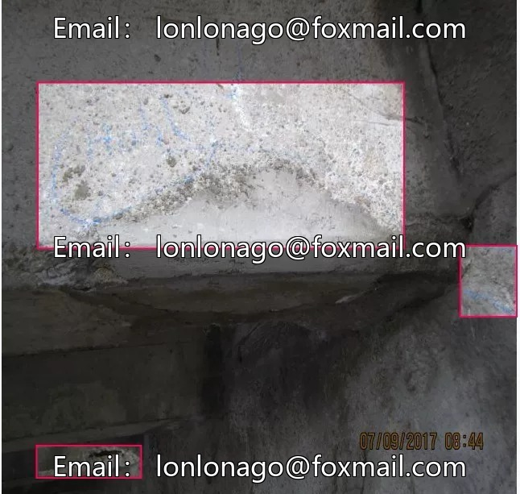
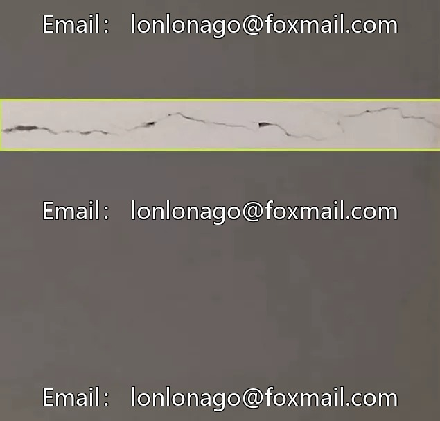
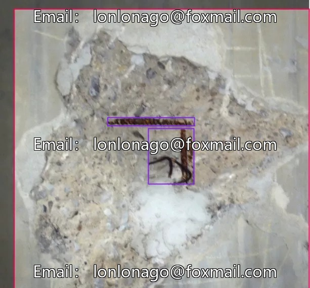
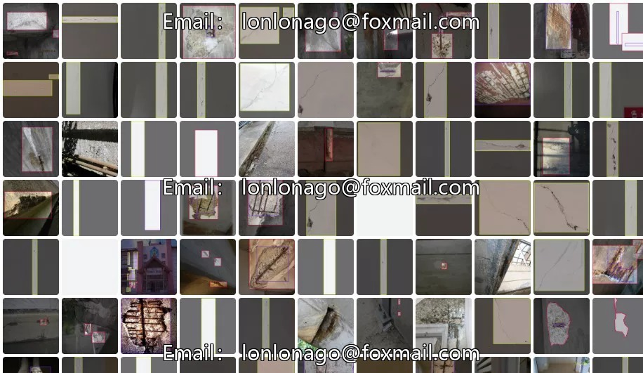
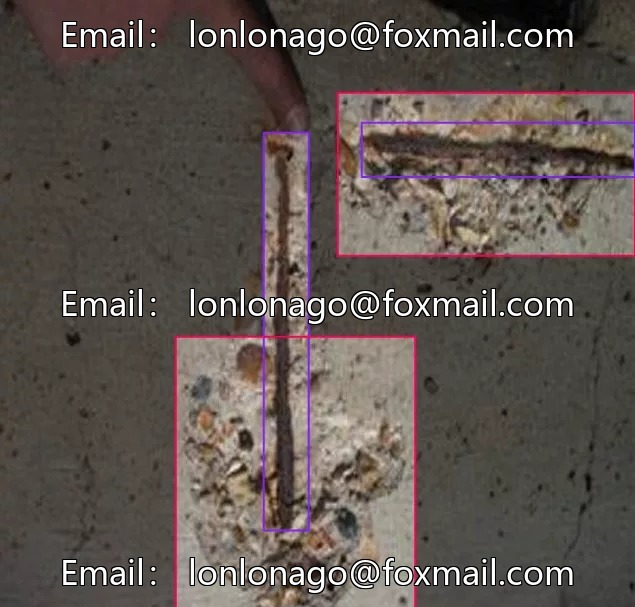
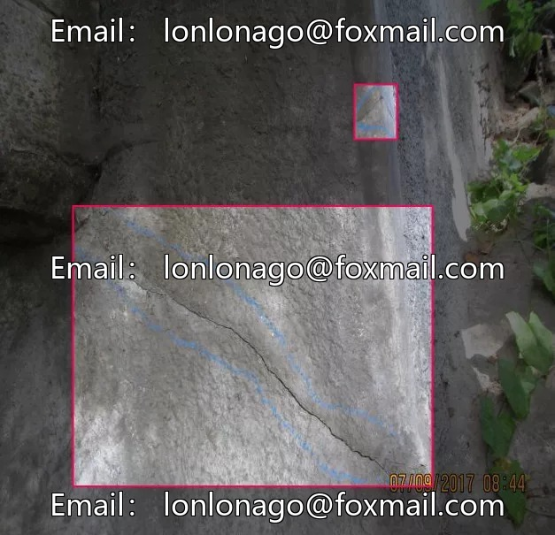
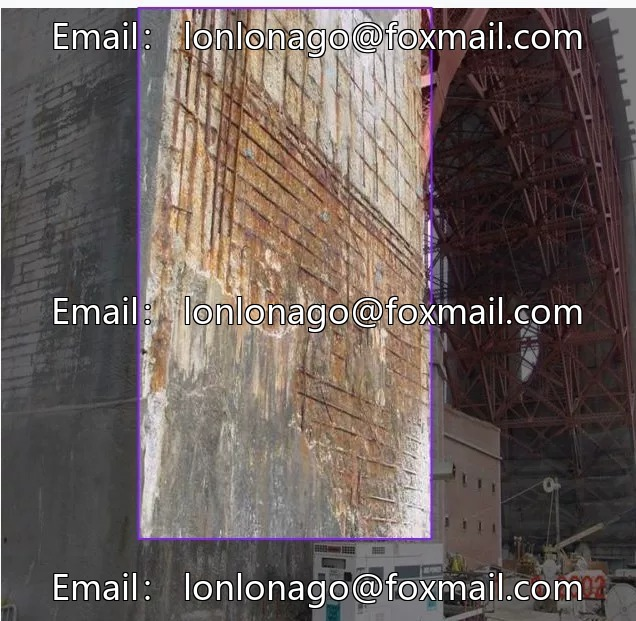
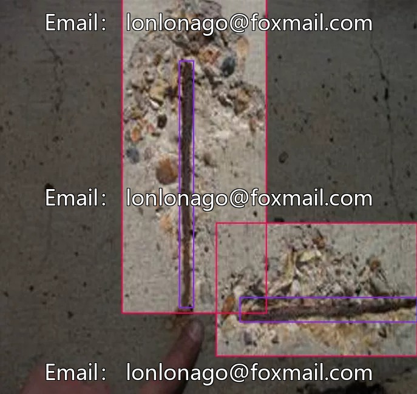

# Dataset of building cracks, exposed rebar, and wall peeling, 2901 images, including cracks.

## Body

Building Cracks, Rendered Rebars, Wall Defects dataset with 2901 images, including three categories of labels: cracks, rebars, and wall deterioration
The dataset covers various building structural defect scenarios, with clear and accurate annotations suitable for AI model training and building quality inspection.
It can be used in fields such as intelligent security and industrial quality inspection to help quickly identify building safety hazards.
The data is available in JPG/PNG image files, accompanied by XML/JSON annotation files.
This is a virtual material, and once sold, there will be .
Interested friends, click "I want" now!

## Images

## Payment

Here is a pay link on Stripe ( https://buy.stripe.com/3cs8yP7sY87d0vu9AB ). Please contact me lonlonago@foxmail.com after funding $89, and I will send you a complete data files , thank you!

